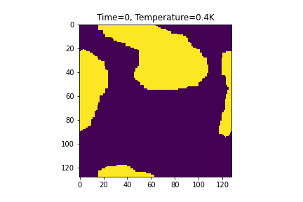
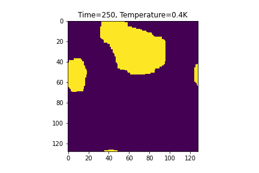
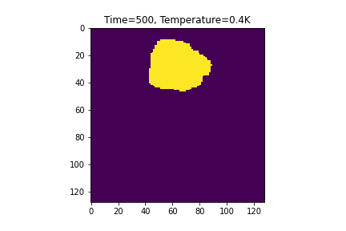
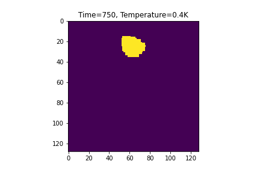
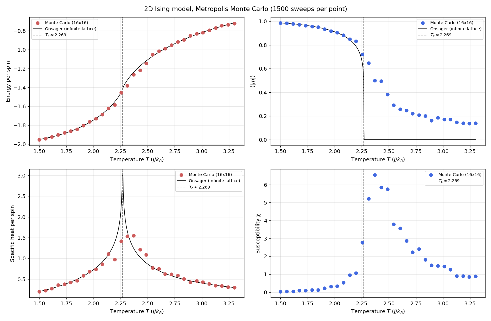
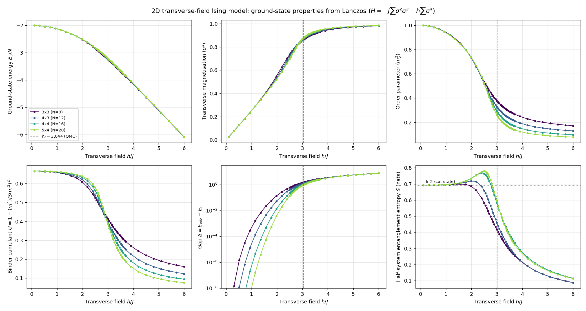
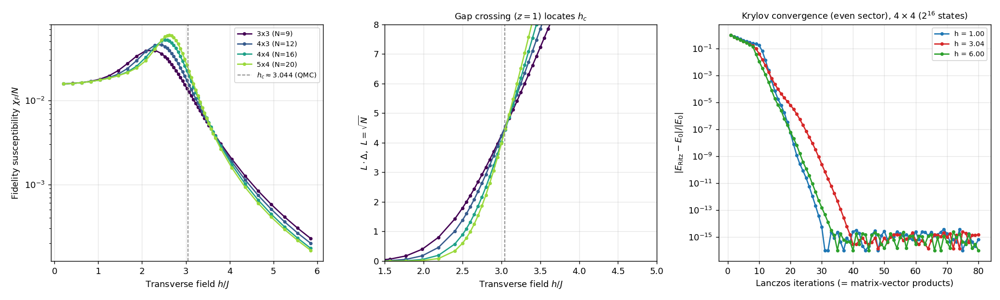
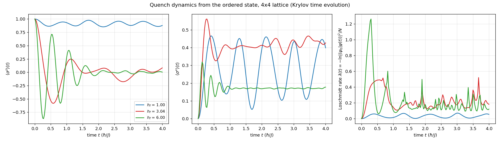
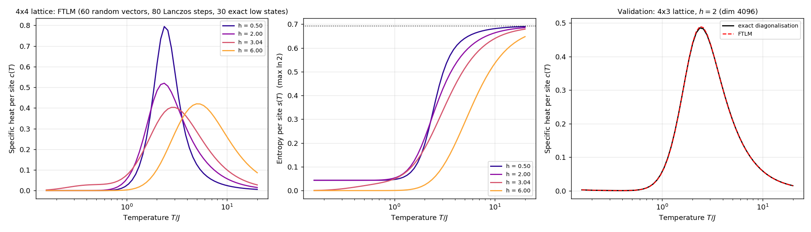

# 2D Ising Model: classical Monte Carlo and quantum Krylov methods

Two complementary simulations of the square-lattice Ising model:

| | **Classical** | **Quantum (transverse field)** |
|---|---|---|
| Hamiltonian | $H = -J\sum_{\langle ij\rangle} s_i s_j - \mu B\sum_i s_i$, $s_i=\pm1$ | $H = -J\sum_{\langle ij\rangle}\sigma^z_i\sigma^z_j - h\sum_i\sigma^x_i$ |
| Driver of the transition | temperature $T$ | transverse field $h$ (at $T=0$) |
| Method | Metropolis Monte Carlo | Lanczos / Krylov subspace methods (exact, matrix-free) |
| Code | [`ising.py`](ising.py) | [`quantum_ising.py`](quantum_ising.py) |
| Plot script | [`classical_demo.py`](classical_demo.py) | [`quantum_demo.py`](quantum_demo.py) |
| Critical point | $T_c = 2J/\ln(1+\sqrt2) \approx 2.269\,J$ (exact) | $h_c \approx 3.044\,J$ (quantum Monte Carlo) |

## Contents

- [Installation](#installation)
- [Classical model](#classical-model)
- [Quantum model](#quantum-model)
- [Tests](#tests)
- [Project layout](#project-layout)

## Installation

```bash
git clone git@github.com:thecomputationguy/2D-Ising-Model.git
cd 2D-Ising-Model
pip install -r requirements.txt
```

## Classical model

`Ising2D` simulates an $N\times N$ periodic lattice with single-spin-flip Metropolis dynamics
($k_B = 1$). One *sweep* is $N^2$ flip attempts. After an equilibration phase (20% of the
requested sweeps) the energy, magnetisation, specific heat and susceptibility are estimated per spin:

$$
C = \frac{\langle E^2\rangle - \langle E\rangle^2}{N^2T^2},\qquad
\chi = \frac{\langle M^2\rangle - \langle |M|\rangle^2}{N^2T}.
$$

```python
from ising import Ising2D

model = Ising2D(N=32, mu=0.0, J=1.0, B=0.0)      # textbook model: no field
model.simulate(num_steps=1000, temperature=2.0)
print(model.energy, model.abs_magnetization, model.specific_heat, model.susceptibility)
```

> [!NOTE]
> The constructor defaults (`J=0.2, mu=0.33, B=1.0`) include a magnetic field, which smears out
> the phase transition. Use `J=1, mu=0, B=0` to see the transition at $T_c\approx2.269$.
> At $B=0$ the two ordered states are degenerate, so the signed mean `magnetization` averages to
> about zero; use `abs_magnetization` as the order parameter.

### Snapshots (128×128 lattice, T = 0.4)

Spin configurations at successive stages of a run started from a random state (`test.ipynb`):

| t = 0 | t = 250 | t = 500 | t = 750 |
|:---:|:---:|:---:|:---:|
|  |  |  |  |

### Temperature sweep vs. the exact solution

16×16 lattice, 1500 sweeps per temperature (`python classical_demo.py`). Black lines are
Onsager's exact infinite-lattice results; the specific heat and susceptibility peaks are rounded and
shifted by the finite lattice size.



### Validation

The classical code is checked in [`tests/test_ising.py`](tests/test_ising.py) against
brute-force enumeration of all $2^{16}$ states of a 4×4 lattice (energy, $|m|$, $C$, $\chi$), plus
exact limits (ground state $E/N=-2J$, checkerboard $+2J$), and a consistency test that the
Metropolis flip energy equals the difference of the total-energy function.

## Quantum model

The transverse-field Ising model (TFIM) adds quantum fluctuations: the field $h\sum\sigma^x$
does not commute with the Ising term, and at zero temperature the system undergoes a **quantum
phase transition** at $h_c\approx3.044\,J$ from an ordered ferromagnet ($h\ll J$, two nearly
degenerate ground states) to a quantum paramagnet ($h\gg J$, spins polarised along $x$). Lattices
are $L_x\times L_y$ tori with up to $N=20$ spins (a Hilbert space of $2^{20}\approx10^6$ states).

### Krylov methods used

The Hamiltonian is **never stored**. A state is a vector of $2^N$ amplitudes and $H|\psi\rangle$
is applied in $O(N\,2^N)$ operations (the Ising term is a diagonal array, each $\sigma^x_i$ is an
axis reversal of the state tensor). The global spin flip $P=\prod_i\sigma^x_i$ commutes with $H$
and is a simple reversal of the vector, so every eigenproblem is solved in a definite parity sector.

| Task | Krylov method | Where |
|---|---|---|
| Ground state, lowest odd level (gap) | Lanczos (`scipy` `eigsh`), warm-started along the field scan | `TFIM2D.ground_state`, `TFIM2D.gap` |
| Real-time evolution $e^{-iHt}\lvert\psi\rangle$ | own adaptive Krylov propagator with an a-posteriori error bound | `krylov_evolve` |
| Thermodynamics $c(T)$, $s(T)$ | Finite-Temperature Lanczos Method (stochastic trace; low-lying states treated exactly) | `ftlm` |
| Convergence study | own Lanczos with full reorthogonalisation | `lanczos` |

```python
from quantum_ising import TFIM2D, krylov_evolve, ftlm

model = TFIM2D(4, 4, J=1.0, h=3.0)           # 16 spins
E0, psi = model.ground_state()               # Lanczos
gap = model.gap(E0)                          # lowest P-odd level - E0
S = model.entanglement_entropy(psi)          # half-system entropy
```

Observables available for any state: $\langle\sigma^x\rangle$, $\langle\sigma^z\rangle$,
$\langle m_z^2\rangle$, the Binder cumulant, $\sigma^z\sigma^z$ correlators, entanglement entropy.
Run `python quantum_demo.py` to regenerate everything below (about 5 minutes, dominated by the
20-spin lattice; `--quick` skips it).

### Ground-state phase transition

Lanczos ground states for 3×3, 4×3, 4×4 and 5×4 lattices. The order parameter and Binder cumulant
sharpen towards the transition, the gap closes exponentially with $N$ in the ordered phase and
opens linearly in the paramagnet, and the entanglement entropy tends to $\ln2$ (the cat state)
for $h\to0$.



### Locating $h_c$ and Krylov convergence

At a $z=1$ transition $L\cdot\Delta$ is size independent at $h_c$. The crossing of the 4×4 and 5×4
curves gives $h_c\approx3.03$ against the literature value 3.044. Other size pairs scatter between
3.02 and 3.13, and the Binder-cumulant crossings (2.7 to 3.0) are lower; both are finite-size
effects of such small lattices. The fidelity susceptibility peaks near the transition and moves towards it as $N$
grows. The right panel shows the Lanczos Ritz value reaching machine precision in about 40
matrix-vector products for 65536 states.



### Quench dynamics

Starting from the fully polarised state $|{\uparrow\cdots\uparrow}\rangle$ and suddenly switching on
a field $h_f$ (4×4 lattice). For $h_f<h_c$ the magnetisation oscillates around a finite value; for
$h_f\ge h_c$ it decays to about zero. The Loschmidt rate shows the return probability of the
initial state.



### Finite-temperature thermodynamics

The Finite-Temperature Lanczos Method gives the specific heat and entropy of the 4×4 lattice
over the full temperature range (left, centre). The right panel validates it against full
diagonalisation on a 4×3 lattice. At small $h$ the entropy plateaus at $\ln 2/N$ below the
temperature scale of the nearly degenerate cat-state pair.



### Validation

[`tests/test_quantum_ising.py`](tests/test_quantum_ising.py) checks the quantum code against:

- the analytic two-spin solution, $E_0=-\sqrt{J^2+4h^2}$;
- the exact Jordan–Wigner free-fermion solution of the 1D transverse-field Ising ring (12 spins);
- dense diagonalisation on small 2D lattices (energies, gap, parity, Hellmann–Feynman for $\langle\sigma^x\rangle$);
- exact limits ($h=0$: $E_0/N=-2J$, Binder cumulant $2/3$, $S=\ln2$; $J=0$: product state);
- the Lanczos tridiagonal relation and monotone convergence;
- Krylov time evolution against `scipy.linalg.expm` (norm and energy conservation, error estimate);
- FTLM against exact thermodynamics.

## Tests

```bash
python -m pytest tests -q
```

## Project layout

```text
ising.py            classical Metropolis simulation (Ising2D)
classical_demo.py   classical temperature sweep + Onsager comparison
quantum_ising.py    quantum TFIM and Krylov routines (TFIM2D, lanczos, krylov_evolve, ftlm)
quantum_demo.py     generates all quantum plots (results/quantum_scan.npz caches the scan)
test.ipynb          notebook to experiment with the classical simulation
tests/              pytest suites for both models
plots/              classical figures; plots/quantum/ holds the quantum figures
```

## References

- Onsager, *Crystal statistics. I*, Phys. Rev. 65, 117 (1944).
- Blöte and Deng, *Cluster Monte Carlo simulation of the transverse Ising model*, Phys. Rev. E 66, 066110 (2002): $h_c/J = 3.04438$.
- Jaklič and Prelovšek, *Lanczos method for the calculation of finite-temperature quantities in correlated systems*, Phys. Rev. B 49, 5065 (1994).
- Hochbruck and Lubich, *On Krylov subspace approximations to the matrix exponential operator*, SIAM J. Numer. Anal. 34, 1911 (1997).
